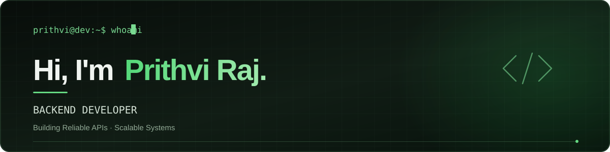

  

  
  

## 👨‍💻 About Me

I'm **Prithvi Raj**, a Backend Developer. I build scalable backend systems, clean APIs, and reliable data layers that power real-world applications.

- 🚀 Backend developer focused on clean, production-ready services
- ⚙️ I enjoy designing REST APIs, working with databases, and building systems that scale
- ⚡ Passionate about clean architecture, performance, and maintainable code
- 🧠 Always learning, currently exploring backend architecture and system design

## 🧩 What I Build

| Area | Focus |
| :-- | :-- |
| REST APIs & services | Spring Boot, Express, FastAPI |
| Data layer | PostgreSQL, MongoDB, Redis, and SQL |
| Web interfaces | HTML, CSS, React |
| Developer workflow | Git, GitHub, IntelliJ, VS Code, Claude Code |

## 🛠️ Tech Stack

### Languages

  

`Java` `TypeScript` `JavaScript` `Python` `SQL`

### Backend Frameworks

  

`Spring Boot` `Express.js` `FastAPI` `REST APIs`

### Frontend

  

`HTML` `CSS` `React`

### Databases

  

`PostgreSQL` `MongoDB` `Redis` `SQL`

### DevOps &amp; Cloud

  

`AWS` `Docker` `CI/CD`

### Tools

  

`Git` `GitHub` `IntelliJ IDEA` `VS Code`

## 🎯 How I Work

I care about more than getting endpoints to respond. I build with clear structure, thoughtful database design, and an eye on performance from the beginning. My goal is simple: create backend systems that are dependable and easy to grow.

## 🌱 Currently Growing In

- Backend architecture and system design
- Building scalable, performance-minded services

  

